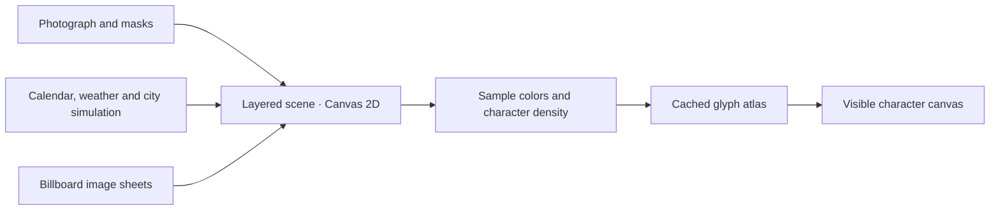

<div align="center">

# ASCII

**An evolving collection of living artworks, rendered in characters.**

Places, light, motion, and atmosphere—explored one artwork at a time.

[**Explore No. 01 ↗**](https://aryamandarda.com/ascii-art/nyc/) · [Artworks](#artworks) · [Development](docs/development.md) · [How it is rendered](docs/rendering.md)

</div>

## Artworks

### 01 · Times Square, New York

The first piece in the series: a fixed street-level view of a city that keeps moving. Billboards, weather, pedestrians, and traffic share one changing New York clock.

[](https://aryamandarda.com/ascii-art/nyc/)

[**Open the artwork**](https://aryamandarda.com/ascii-art/nyc/) · [Rendering notes](docs/rendering.md)

#### Inside this artwork

A photograph provides the architecture; a layered Canvas 2D simulation brings the street to life. The finished scene is sampled into a grid of colored characters on every rendered frame.

- **A changing sky** — New York sunrise and sunset, moon phases, twilight palettes, and individually lit windows.
- **Seasonal weather** — clouds, rain, snowfall, and ground snow that accumulates and thaws across days.
- **A living plaza** — articulated pedestrians, personal space, seating, and time-of-day crowd density.
- **Street traffic** — two-way movement, signals, headlights, brake lights, and reflections.
- **Animated billboards** — ten creatives, perspective-mapped screens, and coordinated campaign takeovers.
- **An explorable clock** — choose a date, pause, reverse time, or change the playback speed and weather.

Built with **vanilla JavaScript and Canvas 2D**. No frontend framework or compilation step. The scene runs locally; a small Cloudflare Worker and Durable Object provide the shared like counter.

## Explore Times Square

Open [**aryamandarda.com/ascii-art/nyc/**](https://aryamandarda.com/ascii-art/nyc/) and select **Immerse**. Press **H** or choose **Hide controls** for an unobstructed view. On phones, the full scene fits the display; **Zoom in** lets you drag through the details.

At **1×**, one simulated minute passes each real second. Speeds range from **0.5× to 5×**. Date, lighting, weather, people, traffic, and billboards follow that clock. The browser respects reduced-motion preferences.

Weather is a seasonal simulation, not a live forecast. Manual weather selections last until you choose **Natural · Date synced** or reload. This is an artwork, not a live camera or advertising feed.

## Run locally

With Python 3 installed:

```sh
git clone https://github.com/aryamandarda/ASCII.git
cd ASCII
python3 -m http.server 8000 --directory web
```

Open [localhost:8000/artworks/nyc/](http://localhost:8000/artworks/nyc/). The artwork works without the like service.

For the complete app, including local likes and the public URL layout, use Node.js 20 or later:

```sh
npm ci
npm run dev:worker
```

Open the local address printed by Wrangler at `/ascii-art/nyc/`.

## Rendering approach



The renderer uses a 1280 × 854 scene, perspective-mapped billboards, a 512-color palette, ordered dithering, and cached glyph pixels. A separate pedestrian mask preserves clothing colors through the character pass. Unchanged character cells reuse their previous pixels.

| Read more | What it covers |
| --- | --- |
| [Rendering the scene](docs/rendering.md) | Compositing order, billboard projection, character conversion, color correction, and performance tradeoffs |
| [Movement and weather](docs/movement-weather.md) | Gait, crowd spacing, vehicles, snow history, equations, and reference measurements |
| [Development](docs/development.md) | Local previews, visual review, tests, and media preparation |
| [Performance and energy](docs/performance.md) | Rendering costs, complete-frame startup, and battery measurement limits |
| [Hosting](docs/hosting.md) | Cloudflare routing and integration with the future personal website |

## Development

```sh
npm test                # Scene regressions; Node.js 20+ and FFmpeg
npm run test:worker    # Routing and like service; run npm ci first
```

Each artwork has its own folder under `web/artworks/`. Times Square lives in [`web/artworks/nyc/`](web/artworks/nyc/). Shared project areas are [`server/`](server/), [`tools/`](tools/), [`tests/`](tests/), and [`docs/`](docs/).

For a bug report, include your browser and operating-system version, viewport size, scene date and weather, and steps to reproduce it. Changes to the scene should preserve the shared clock and include a visual review as well as the relevant regression checks.

## Credits and rights

Created by [**Aryaman Darda**](https://github.com/aryamandarda).

Campaign imagery, source photography, and SunCalc retain their respective rights and notices. See [third-party notices](docs/third-party-notices.md) before reusing assets. No blanket license to the included photography or advertising artwork is implied.
